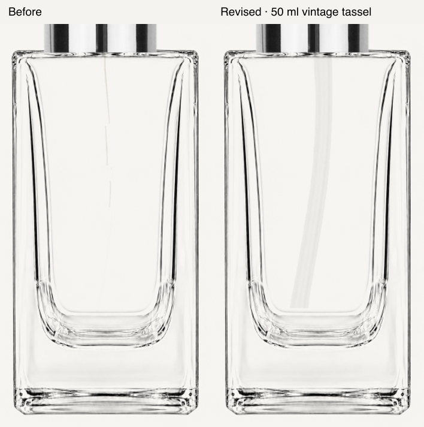

# Media review branch, 14 October 2026

Draft PR preparation authorized by Jordan. This branch preserves the earlier image recovery, catalogue audit, Boston source review and footer fixes, plus the local artwork integration developed in this chat.

## Included

- Four source-faithful silver Tassel finishes and ten Diva jeweled-ring candidates, with exact source and registration guards.
- Empty 50 ml and 100 ml Empire body masters in local PDP and Builder paths. Ninety captured assemblies use the masters; the exact 100 ml white-pump/clear-cover combination remains held.
- Separate reducer and photographed pipette layers, cavity clipping and seated tube blending. The intact Photoshop tube replaces the damaged 50 ml vintage/tassel extraction in 18 captured combinations.
- Read-only, opt-in replay of captured catalogue data for local family review. The active snapshot remains ignored and is not part of the commit.
- Source extraction/export safety checks, audit tools, exact-SKU tests and acceptance notes.

## Visual evidence

These are offline renders using the shared PDP and Builder layouts. They are not browser screenshots or visual approval.

[50 ml and 100 ml tube depth comparison](assets/empire-tube-depth-before-after.png)

The full local review has 144 PDP renders and 540 Builder layouts. Its latest update regenerates the 18 affected vintage/tassel views and 108 Builder layouts. Unchanged renders retain their prior evidence.

## Verification and review

- The nine server-only import failures were reproduced and corrected with explicit test-only mocks in the affected suites. The Next server boundary is retained.
- Final verification: 344 Vitest suites and 3,131 tests pass; 2 suites and 7 tests are intentionally skipped. TypeScript, changed-source ESLint and four Python export-safety tests pass. The system Python lacked NumPy; the existing image-work virtual environment supplied the export-test dependencies.
- Independent review found two issues: the test imports and static artwork upload exclusion. Both were corrected. No further important issue was reported.
- Local artwork is excluded by `.vercelignore` as well as being disabled by production selection guards. No backend schema deployment, asset publication, reference mutation or production deployment was run.

## Still held

Browser acceptance is pending because saved browser permissions deny localhost access. Physical iPhone checks, owner visual approval of current corrections, catalogue-wide visual reconciliation and the held exact white-pump source are open. Catalogue cards retain their captured published images. The branch is not launch approval.

No merge or production rollout is authorized by this PR request. The existing worktree and local evidence remain available for review.
